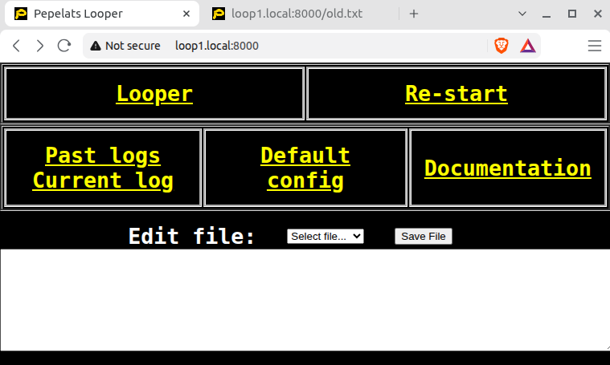
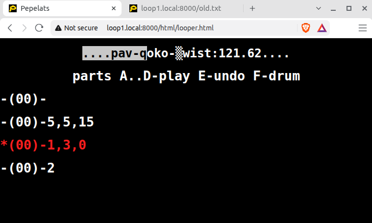
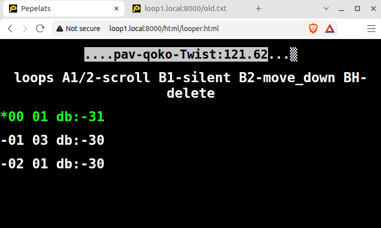
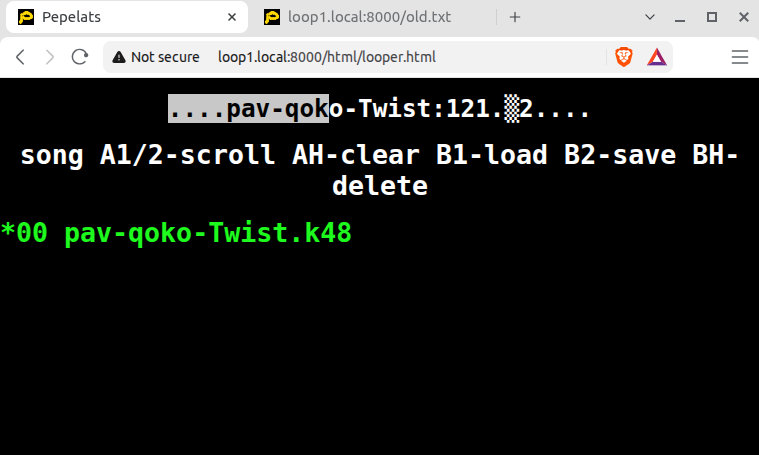
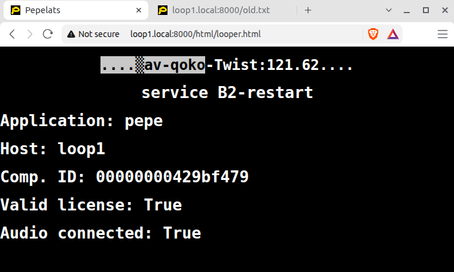
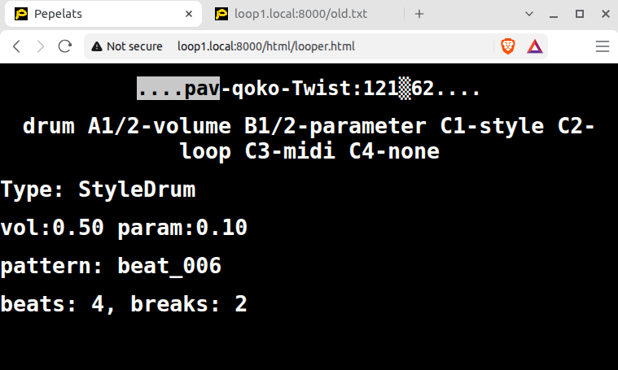
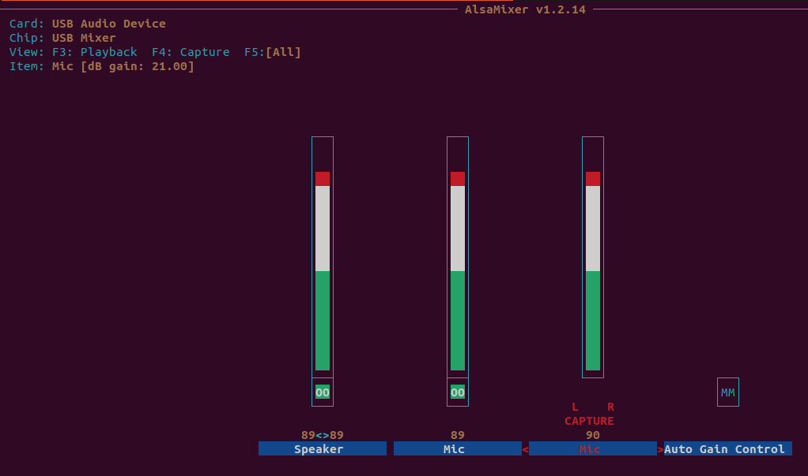

# Pepelats – audio looper with drums on Raspberry Pi

## Main Web page

This starting page is available only if looper uses Web. When looper uses screen this page is not available. All other screenshots look similar on Web pages and on screen / terminal.

## **Play menu, section for parts**

There are 4 song parts shown in here. List of numbers (ex: **5,5,15**) shows how many loops each part has and number of bars in each loop.

Number in parentheses **-(00)-** shows how many “undone” loops each part has. After “redo” this number decreases after “undo” – increases.

Part marked with star **\*** is **current part**. Red color shows that it is recording. Green color shows that it is playing. 

Yellow color shows the **next part that will **become **current part** when **current part** comes to end. If there is no **next part the state of looper will not change.**

On top the **progress bar** shows two markers – inverse color for **base loop** position and solid block ▒ the **longest loop** position.

## Play menu, section for loops

In this section we see number of bars for each loop and decibels level for each loop.

## Song menu, section for songs

In song menu songs may be scrolled, cleared, loaded, saved, deleted.

## Song menu, section for drum configuration

Another section of song menu allows to change drum configuration (e.g. Disco, Blues,).

## Service menu, section for re-start

This section is to provide information and restart.

## Service menu, section for drum parameters

This section is to change volume and randomness of drum. Additionally, it allows to change drum type – this will make an empty song with selected drum type.

## **ALSA control**

